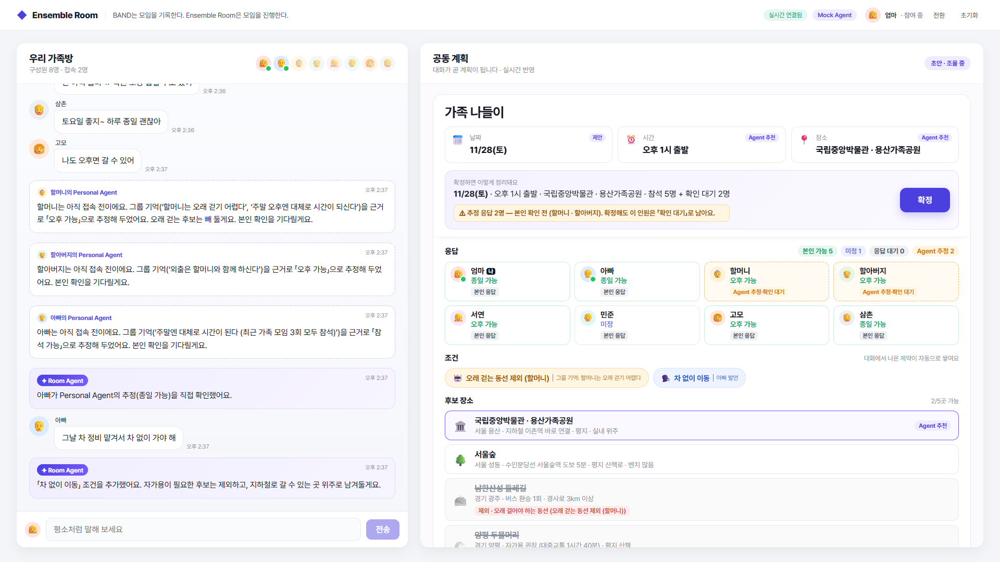
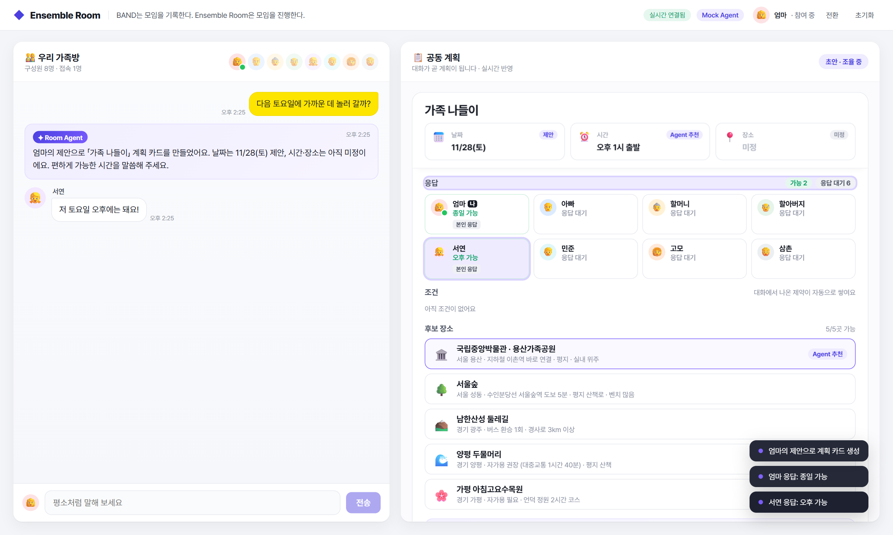
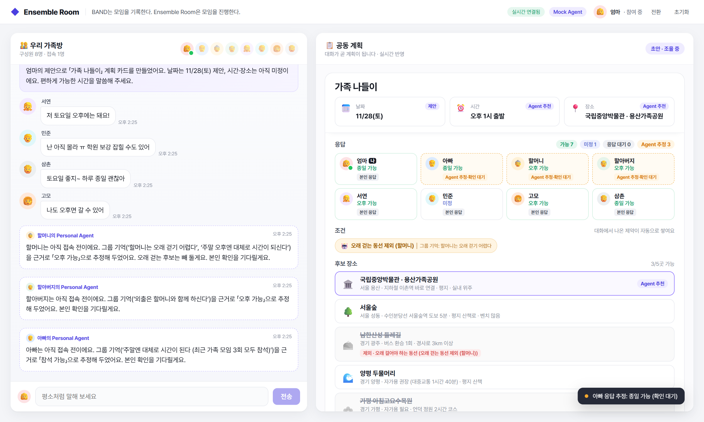
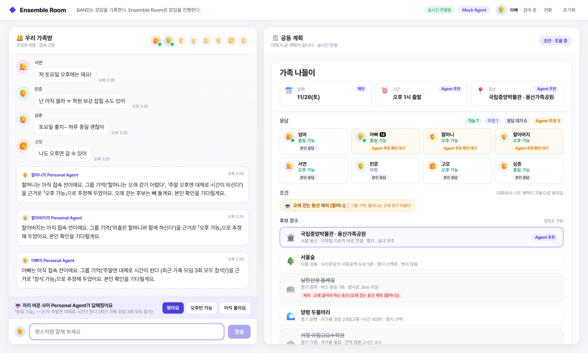
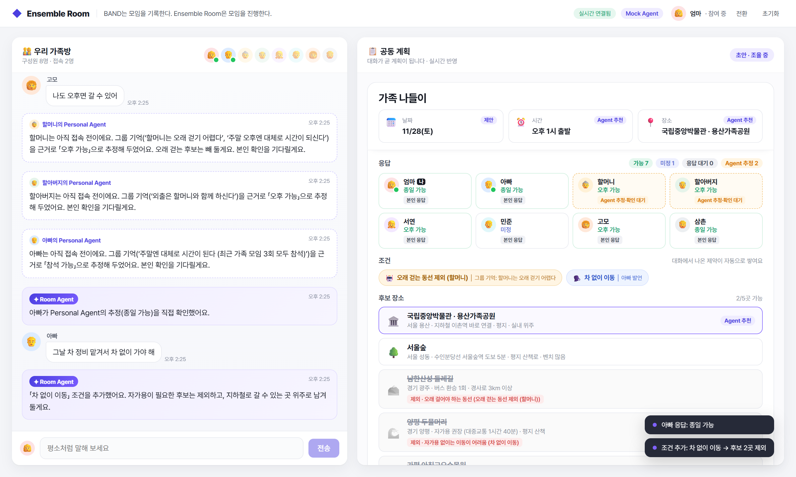
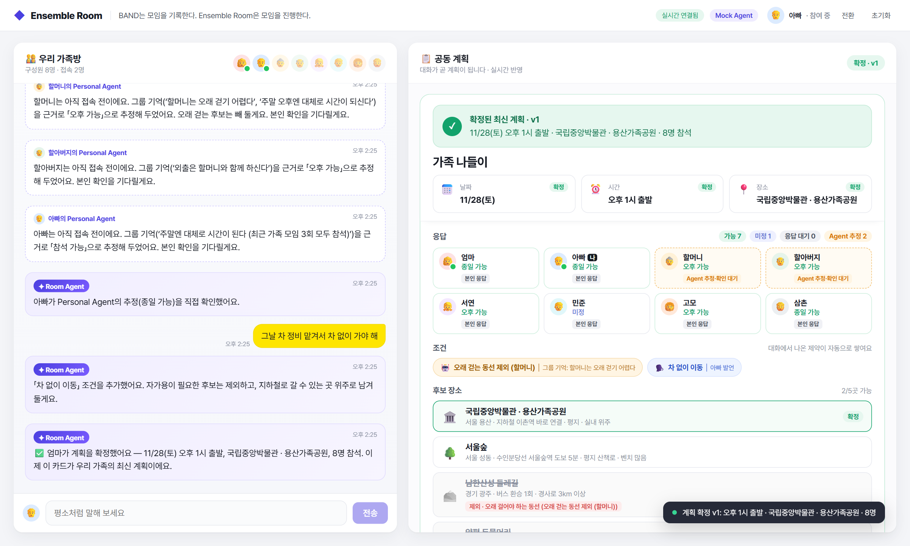
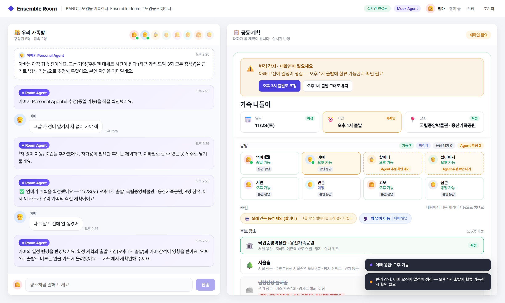
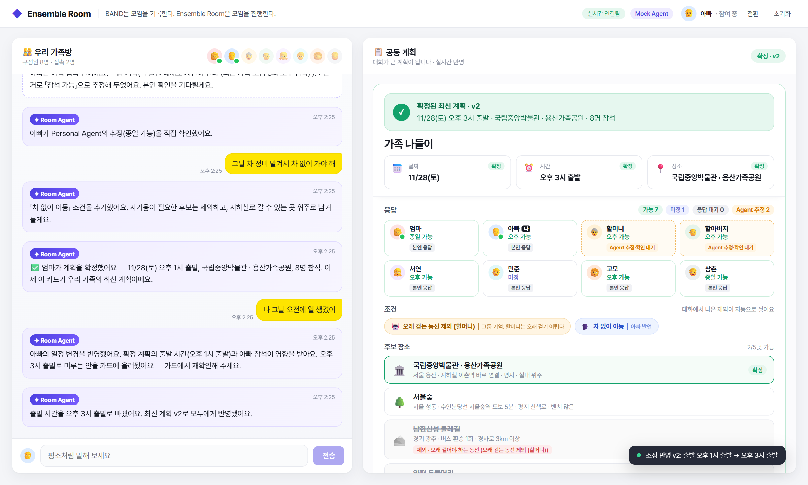

# Ensemble Room — agentic BAND 라이브 데모

> **BAND는 모임을 기록한다. Ensemble Room은 모임을 진행한다.**
> 가족 단톡방에서 평소처럼 말하면, 에이전트가 그 대화를 하나의 공동 계획으로 유지합니다.
> 관전 포인트: **왼쪽에서 말하면 오른쪽 plan 카드가 실시간으로 바뀐다.**



> 🎬 **폴백 영상**: [docs/demo-fallback.mp4](docs/demo-fallback.mp4) (83초, 1920×1080, 장면 자막 포함) — 라이브가 불가능할 때 재생.
>
> 🧊 **Freeze: 목 11/26 정오** — 이후 기능 변경 금지, 버그 수정만.

## 데모 구동 (5분)

필요: Node.js 20 이상 (검증: Node 24.22 / npm 11.19, Windows 11).

```bash
npm install
npm run dev          # 서버(:8787) + 웹(:5173) 동시 기동, AGENT_MODE=mock
```

1. 브라우저 **탭 1**에서 http://localhost:5173 → **엄마** 선택.
2. 아직 탭 2는 열지 않습니다 (아빠는 "미접속" 상태여야 Personal Agent가 대신 답합니다).
3. 아래 대본대로 진행. 다시 하려면 우측 상단 **초기화** (모든 탭에 즉시 반영).

> 탭마다 세션이 분리됩니다(sessionStorage). 같은 브라우저의 새 탭이면 됩니다.
> 발표 화면은 1920×1080 와이드 기준으로 맞췄습니다 (브라우저 전체화면 F11 권장).

### 리허설 자동 점검

```bash
npm run check   # (dev 실행 중) API만으로 시나리오 1~6 검증 — 약 25초
npm run e2e     # (dev 실행 중) Edge로 두 탭을 띄워 UI로 1~6 진행 + docs/screenshots 갱신
VIDEO=1 npm run e2e && npm run video   # 두 탭 녹화 → 자막 달린 docs/demo-fallback.mp4 합성 (ffmpeg 필요)
```

녹화 최초 1회는 `npx playwright-core install ffmpeg`(Playwright 전용 ffmpeg, 사용자 캐시에만 설치)가 필요합니다.

`npm run e2e`는 설치된 Microsoft Edge를 사용합니다 (`BROWSER=chrome`으로 Chrome, `HEADED=1`로 창 표시).

## 시나리오 대본

| # | 누가 (탭) | 입력 / 동작 | 오른쪽 카드에서 일어나는 일 |
|---|---|---|---|
| 1 | 엄마 (탭 1) | `다음 토요일에 가까운 데 놀러 갈까?` | Room Agent가 「가족 나들이」 카드 생성 — 날짜 제안, 시간·장소 미정, 7명 응답 대기 |
| 2 | (자동) 서연·민준·삼촌·고모 | 약 10초간 순서대로 답함: "오후에는 돼요", "아직 몰라", "하루 종일 괜찮아", "오후면 갈 수 있어" | 각자 칩이 `오후 가능 / 미정 / 종일 가능`으로 바뀌고 **본인 응답** 배지. 시간 칸이 "오후 1시 출발 (Agent 추천)"으로 |
| 3a | (자동) Personal Agent | 미접속인 할머니·할아버지·아빠 대신 추정 | 칩에 **Agent 추정·확인 대기** 배지 + 점선. 할머니 그룹 기억("오래 걷기 어렵다") → 조건 칩 `오래 걷는 동선 제외` 자동 추가, 남한산성·아침고요 취소선 |
| 3b | 아빠 (**탭 2** 새로 열어 로그인) | 채팅 아래 배너 "자리 비운 사이 Personal Agent가 답해뒀어요" → **[맞아요]** | 아빠 칩이 한 번에 **본인 응답**으로 |
| 4 | 아빠 (탭 2) | `그날 차 정비 맡겨서 차 없이 가야 해` | 조건 칩 `차 없이 이동` 추가 → 두물머리 제외(사유 표시). 남은 후보 2/5곳 |
| 5 | 엄마 (탭 1) | 카드 상단 **[확정]** 옆 경고 "추정 응답 2명 — 본인 확인 전"을 짚고 클릭 (원하면 먼저 서울숲 클릭해 장소 변경) | 초록 확정 배너 v1: 날짜 · 오후 1시 출발 · 국립중앙박물관 · **참석 5명 확정 + 확인 대기 2명**(할머니·할아버지). 추정 응답은 확정으로 승격되지 않음 |
| 6 | 아빠 (탭 2) | `나 그날 오전에 일 생겼어` | **재확인 필요** — 시간 칸·아빠 칩 주황 하이라이트, 경고 배너에 "오후 3시 출발로 조정 / 그대로 유지" |
| 6b | 누구든 | 배너에서 **[오후 3시 출발로 조정]** | 확정 배너 v2로 갱신, 양쪽 탭 동시 반영 |

### 확정 신뢰 규칙 (발표 포인트)

**타인의 승인 하나로 부재자를 확정하지 않는다.** Personal Agent의 추정 응답(`by: agent`)은
- 확정 전: 확정 영역에 `⚠ 추정 응답 n명 — 본인 확인 전` 경고, 미리보기에 "참석 n명 + 확인 대기 m명"
- 확정 후: 확정 배너·상태 칩에 **확인 대기 m명**이 계속 남고, 해당 칩은 `Agent 추정·확인 대기` 배지 유지
- 본인이 들어와 응답하면 즉시 `본인 응답`으로 바뀌고 확인 대기에서 빠짐 (변경 기록에 "확인 대기 해소")

미정(`maybe`) 응답도 참석 인원에 넣지 않습니다.

팁

- 2~3a의 자동 진행(약 15초)이 끝날 때까지 다음 입력은 잠시 기다리세요. 그 사이에 입력해도 큐 순서대로 처리돼 결과는 같습니다.
- 우측 하단 토스트와 보라색 깜빡임이 "방금 바뀐 곳"을 보여줍니다. 카드 맨 아래 **변경 기록**에 전체 이력이 남습니다.
- 서버를 재시작해도 `data/events.jsonl`을 재생해 같은 상태로 복구됩니다.

### mock 에이전트가 알아듣는 표현

| 의도 | 키워드 (예) |
|---|---|
| 계획 생성 (계획이 없을 때) | 놀러, 나들이, 소풍, 여행 (+ "토요일" 이면 날짜 제안) |
| 응답: 가능 | 돼, 가능, 괜찮, 갈 수, 좋아, 콜 (+ "오전"/"오후"면 시간대) |
| 응답: 미정 / 불참 | 아직 몰라, 모르겠, 글쎄 / 못 가, 안 돼, 불참 |
| 조건 | 차 없이, 대중교통 → 자가용 필요 후보 제외 · 오래 걷, 많이 걷 → 긴 동선 제외 |
| 확정 후 변경 | 일 생겼, 약속 생겼, 급한 일 (+ "오전"이면 오후 3시 조정안 제시) |

## 구조

```
shared/   types.ts(도메인 모델) · reducer.ts(순수 reducer) · planLogic.ts(파생 규칙) · seed.ts(가족 8명·후보 5곳)
server/   index.ts(HTTP+SSE) · store.ts(append-only 이벤트 로그, 단일 쓰기 경로 dispatch)
          agent/index.ts(직렬 큐·스케줄러) · agent/tools.ts(도구→이벤트) · agent/mock.ts(결정적 키워드 에이전트) · agent/claude.ts
web/      React 2패널 — ChatPanel(가족방) · PlanBoard(라이브 plan 카드)
scripts/  scenario-check.mjs(API 리허설) · e2e-demo.mjs(브라우저 리허설+스크린샷)
```

- 모든 상태 변경은 `store.dispatch(event)` 하나로만 일어나고, 웹은 SSE로 받은 상태를 그릴 뿐입니다.
- 에이전트(mock/claude 공통)는 `create_plan · record_response · add_condition · flag_change · say` 도구만 호출할 수 있습니다.
- plan 상태: `responses {userId → prefer|maybe|no|pending, by: human|agent}`, `conditions [{text, excludes[]}]`, 시드된 후보 장소, `status draft|confirmed`, `version`, 변경 기록.
- [EnsembleRoom](https://github.com/jovinus302/EnsembleRoom)의 아키텍처(이벤트 로그 + 순수 reducer + 단일 dispatch + 에이전트 도구 경로)를 따르되, 3D 월드·초대/퇴장 흐름 없이 이 시나리오에 맞게 가볍게 새로 작성했습니다.

## 환경 변수

| 변수 | 기본 | 설명 |
|---|---|---|
| `AGENT_MODE` | `mock` | `claude`는 아직 비활성(현재 항상 mock으로 동작) — 리허설 안정성 우선 |
| `AGENT_THINK_MS` | `700` | 에이전트 "작성 중" 연출 시간 |
| `SEED_SCRIPT` | (on) | `off`면 2단계 자동 응답을 끕니다 |
| `API_PORT` | `8787` | 서버 포트 |

## 장면별 스크린샷

| 1. plan 카드 생성 | 3. 추정 응답 배지 |
|---|---|
|  |  |
| **3b. 본인 한 번에 확인** | **4. 조건 필터링** |
|  |  |
| **5. 확정 전 경고 (신뢰 규칙)** | **5. 확정 — 확인 대기 유지** |
|  |  |
| **6. 변경 감지** | **6. 조정 → 최신 계획 v2** |
|  |  |
